# PlotExtractor

**Plot-wise images from Phase One drone flights.** PlotExtractor takes a drone flight
processed in Agisoft Metashape and gives you one original-quality image per field plot,
ready for phenotyping, labelling and training models. It covers the whole chain:
making and editing the plot grid, cutting each plot from the photos (or developing it
straight from the Phase One IIQ raw files), cutting training tiles from the middle crop
rows, and checking every output against its source.

Developed by DPIRD (Department of Primary Industries and Regional Development, Western
Australia) for the WA node of the Australian Plant Phenomics Network (APPN).

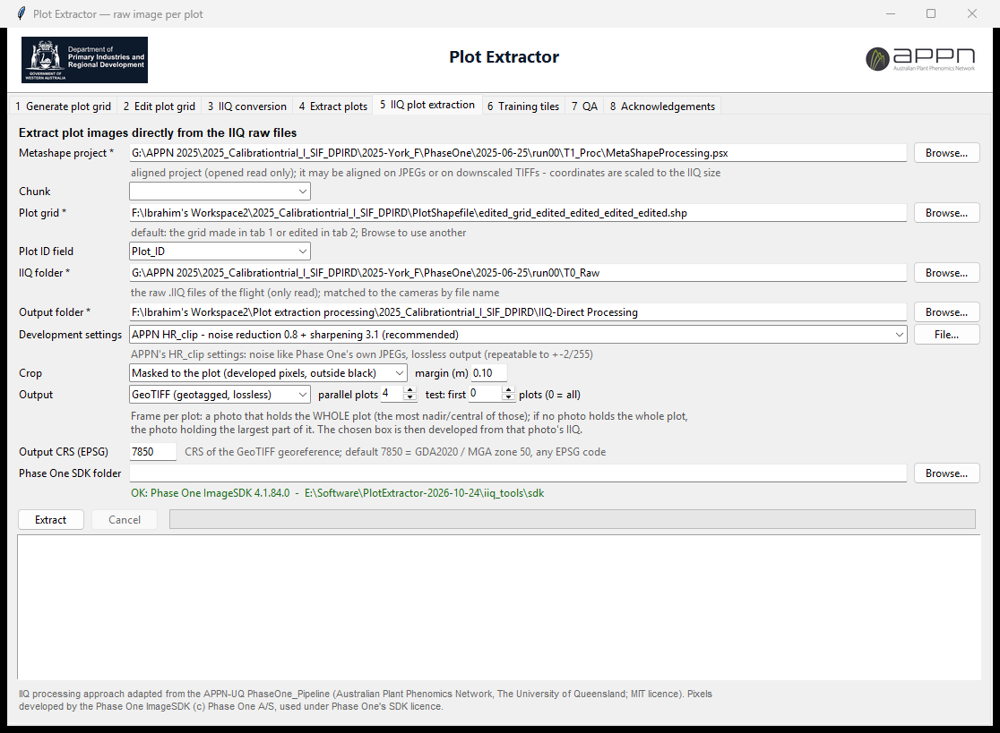

**Download:** [latest release](https://github.com/appndpird/plot-extractor/releases/latest)
(Windows 64-bit, no Python needed) · **Guide:**
[User Guide (PDF)](docs/PlotExtractor_User_Guide.pdf) ·
[Technical Report (PDF)](docs/PlotExtractor_Technical_Report.pdf) ·
[Narrated demo video (MP4)](https://github.com/appndpird/plot-extractor/releases/download/v2026.10.30/PlotExtractor_Demo.mp4)

## Why

A plot is usually visible in several overlapping drone photos, and the orthomosaic
resamples and blends them. PlotExtractor projects each plot polygon into every aligned
photo with Metashape's full camera model and cuts the plot from the single best photo,
so the plot image keeps the camera's original pixels: on the York 2025 calibration trial
686,638,625 of 686,638,625 pixels were identical to the source photos. Plots that no
single photo holds can be stitched from several photos instead.

## Features

- **Plot grid on the orthomosaic** - draw a grid from the 4 trial corners and the
  layout, then move, reshape, grow, widen, lengthen or shift plots, or re-centre them on
  the drilled rows. Works on any RGB orthomosaic, no Metashape licence needed.
- **One image per plot from the photos** - the frame holding the whole plot (or the
  largest part), cut unchanged; masked, bounding-box, native or rectified/stitched
  styles; GeoTIFF with an affine georeference, PNG, TIFF or JPEG.
- **IIQ-Direct** - each plot developed straight from the Phase One IIQ raw file with the
  Phase One ImageSDK (approach of APPN, The University of Queensland, extended).
  Lower noise and more fine detail than the JPEGs.
- **IIQ conversion** - IIQ to TIFF (8/16 bit), georeferenced GeoTIFF or JPEG.
- **Training tiles** - tiles of a fixed ground size (1 m x 1 m by default), the same
  pixel size on every plot, from the middle N crop rows (row detection with tilt) or the
  whole plot, kept away from the bare plot ends; georeferenced GeoTIFFs linked to their
  source photo / IIQ.
- **Rows and row tiles** - whole crop rows (all, middle N or chosen rows) and same-size
  tiles (e.g. 1 m along the row) along each row, in one folder per plot.
- **Recipe file** - every run records its settings in `PlotExtractor_recipe.json`;
  *Load recipe...* repeats them.
- **8 or 16 bit, LZW or uncompressed** - tab 5 develops plots at 8 or 16 bit; every
  TIFF / GeoTIFF is written with GDAL, LZW (lossless) or uncompressed, same pixels.
- **QA** - every crop checked against its source (pixel-identical for JPEGs, a fresh
  development for IIQs), tiles against crops, rows; pictures per plot.
- **Coordinate system** - outputs in EPSG:7850 (GDA2020 / MGA zone 50) by default,
  following the orthomosaic's CRS when one is loaded; any EPSG code can be chosen.
- **Safe with source data** - the Metashape project is opened read-only, the IIQ folder
  is never written to and every IIQ used is re-checked unchanged after a run.

## The tabs

| # | Tab | What it does |
|---|---|---|
| 1 | **Generate plot grid** | Builds the plot shapefile on an RGB orthomosaic: click the 4 trial corners, set ranges / rows / plot size, *Save & use*. No Metashape needed. |
| 2 | **Edit plot grid** | Edits a grid on the RGB orthomosaic: move, reshape, grow/shrink, width, length, shift (one plot, a selection or all), and *Correct grid to rows*. Saves `<grid>_edited.shp` (or `_refit.shp`) beside the input, which is never changed. |
| 3 | **IIQ conversion** | Phase One IIQ raw files → TIFF (8/16 bit), GeoTIFF (georeferenced from the aligned cameras) or JPEG, with the Phase One ImageSDK. |
| 4 | **Extract plots** | One image per plot cut from the Phase One JPEG/TIFF renditions (bit-identical pixels), optional rectified/stitched and orthomosaic crops. |
| 5 | **IIQ plot extraction** | The same extraction, but each plot's box is developed directly from its IIQ raw file (approach of the APPN-UQ PhaseOne_Pipeline, with our changes - see tab 8). 8 or 16 bit; LZW or uncompressed. |
| 6 | **Training tiles** | **6a** tiles of a fixed ground size (1 m x 1 m by default, the same pixel size on every plot) from the middle N crop rows or the whole plot; **6b** whole rows (all / middle N / chosen rows) and same-size tiles along each row. Georeferenced, linked to the source photo / IIQ; settings saved in a recipe file. |
| 7 | **QA** | Checks crops against their source (JPEG or a fresh IIQ development), tiles against crops, rows; per-plot pictures. |
| 8 | **Acknowledgements** | Credits APPN (The University of Queensland) and Phase One for the IIQ plot extraction and lists what we changed in their method. |

| | |
|---|---|
| 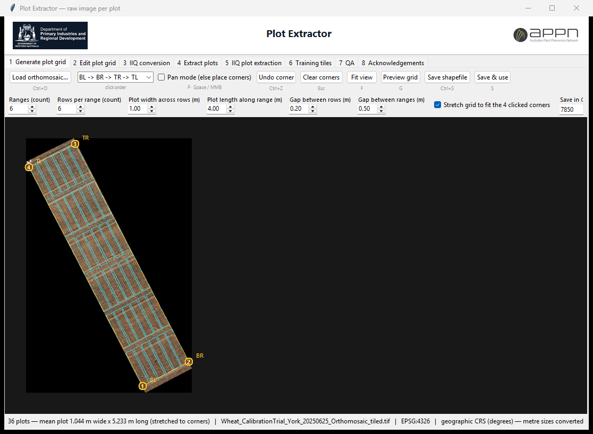 **1 · Generate plot grid** | 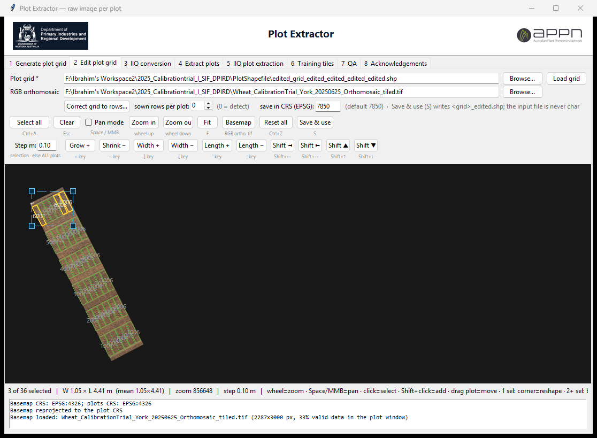 **2 · Edit plot grid** |
| 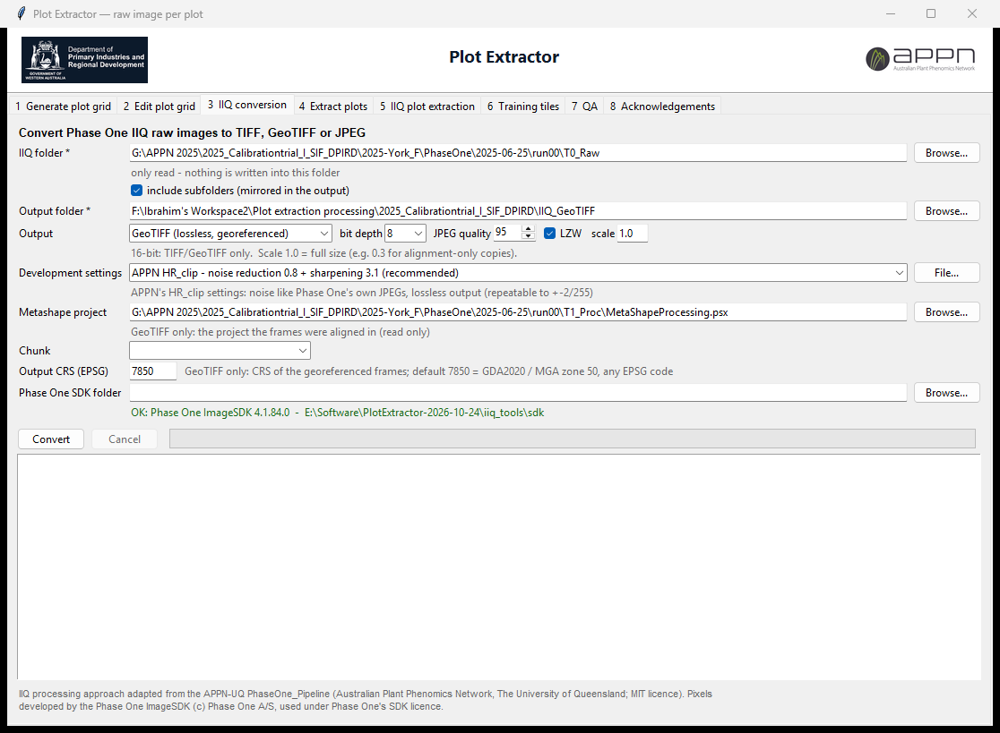 **3 · IIQ conversion** | 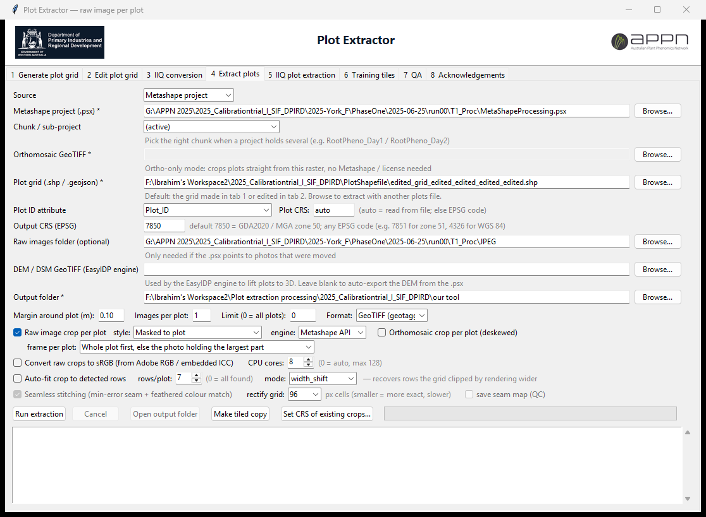 **4 · Extract plots** |
| 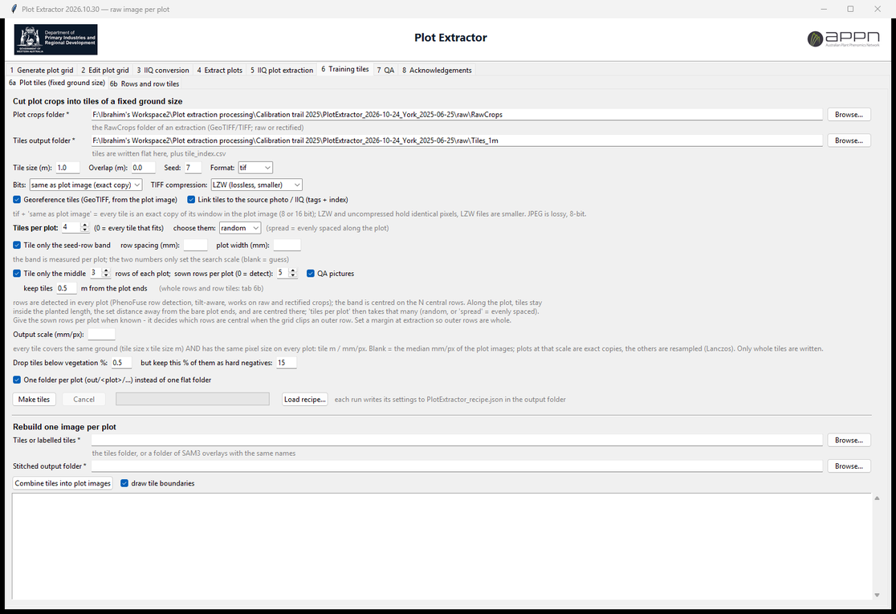 **6 · Training tiles** | 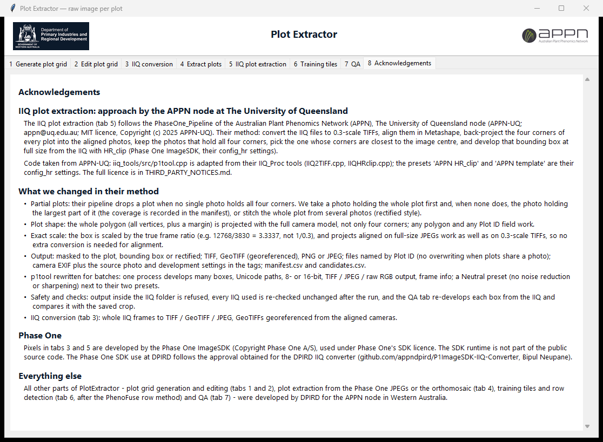 **8 · Acknowledgements** |

**The current grid.** The grid saved in tab 1 or tab 2 becomes the *current grid*: tab 2
loads it for editing, and tabs 4 and 5 use it by default. Each of tabs 4 and 5 can still
be pointed at any other plots file with *Browse*. Plot grids are made and edited on RGB
orthomosaics.

**Coordinate system.** Every output is written in **EPSG:7850 (GDA2020 / MGA zone 50)** by
default: the grids saved in tabs 1 and 2 (reprojected from the orthomosaic's or the input
file's CRS) and the georeferenced images of tabs 3, 4 and 5. Each tab has an *Output CRS
(EPSG)* / *Save in CRS* field to choose another code (e.g. 7851 for MGA zone 51, 4326
for WGS 84). Input grids and orthomosaics may be in any CRS.
When an orthomosaic is loaded in tab 1 or 2, all these fields **follow the orthomosaic's
CRS**: a projected orthomosaic gives its own EPSG code; a lon/lat one (e.g. WGS 84) gives
its local GDA2020 / MGA zone (7850 at York). The log says so, and any field can still be
changed afterwards.

## Two ways to get the plot images: JPEG (tab 4) or IIQ (tab 5)

Both find the plot the same way; they differ in where the raw sensor data is turned into
a colour picture.

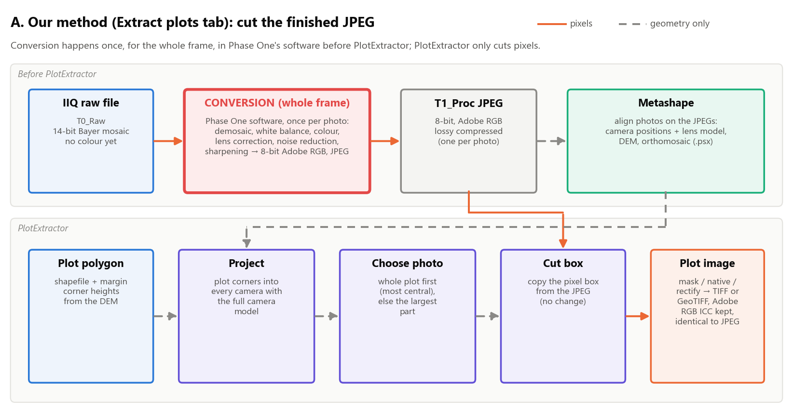
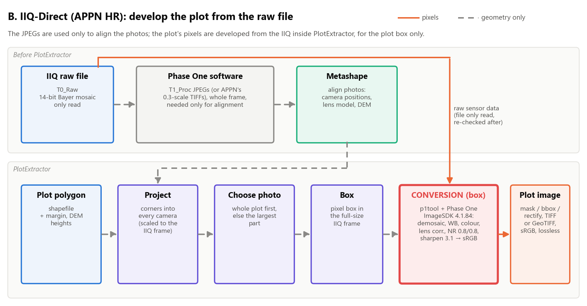

| York 2025, 29 plots on the same photo | Tab 4 (T1_Proc JPEG) | Tab 5 (IIQ, APPN HR settings) |
|---|---|---|
| Pixels | identical to the JPEG | developed from the raw file, lossless |
| Brightness noise (median) | 3.55 | **3.13** |
| Detail / noise | 5.4 | **7.4** |
| Alignment between the two | - | 0.01-0.02 px |
| Colour | Phase One JPEG (Adobe RGB) | SDK (sRGB), slightly less green |
| Needs | Metashape licence | + IIQ files + Phase One ImageSDK |

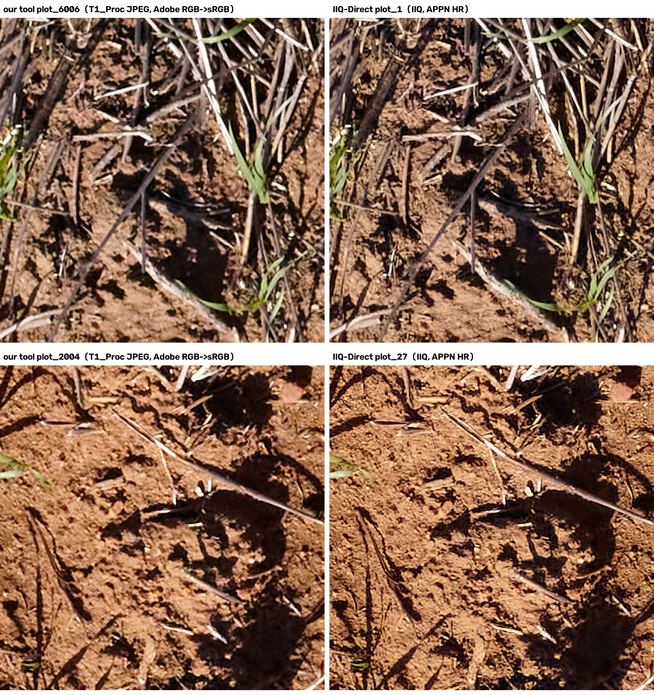

Use one pixel source per trial and season: vegetation indices from the two are not
interchangeable (same plot ranking, different absolute values).

## Download and install

1. Download `PlotExtractor-<date>-win64.zip` from the
   [Releases](https://github.com/appndpird/plot-extractor/releases) page, unzip it
   anywhere and run `PlotExtractor\PlotExtractor.exe` (Windows 10/11 x64).
2. Tabs 3 (GeoTIFF), 4 and 5 need an Agisoft Metashape licence reachable from the PC
   (node-locked or floating). Tabs 1, 2, 6 and 7 need no licence.
3. Tabs 3 and 5 need the **Phase One ImageSDK**, which is licensed by Phase One A/S and
   is **not** included in the download. With an SDK from Phase One, set *Phase One SDK
   folder* on tab 3/5 to the SDK folder (with `lib\ImageSdkCpp.dll` and
   `SensorProfiles\`). The status line turns green when it is found.

`PlotExtractor.exe --selftest` checks the libraries and the Metashape licence.

## Quick start

1. **Tab 1** - load the RGB orthomosaic, click the 4 trial corners, set ranges, rows and
   plot size, *Preview*, *Save & use*. (Or load your own grid in **tab 2**.)
2. **Tab 2** - fine-tune plots over the orthomosaic, *Save & use*.
3. **Tab 4** - choose the Metashape project (.psx) and the flight's `T1_Proc\JPEG`
   folder; the grid is already filled in. Margin 0.10 m, *Masked to plot*, GeoTIFF.
   Test with *Limit* 3, then run all. For the highest quality use **tab 5** with the
   flight's `T0_Raw` IIQ folder instead.
4. **Tab 6a** - tiles from `<output>\RawCrops`: tile size 1.0 m, middle 3 rows, sown
   rows per plot, 0.5 m from the plot ends; format tif, bits *same as plot image*, LZW,
   *Georeference tiles* and *Link tiles to the source photo / IIQ* on. **Tab 6b** - rows
   `all`, whole rows + 1 m row tiles.
5. **Tab 7** - run the checks on the output and the tiles.

Each run writes `RawCrops\plot_<Plot_ID>.tif`, `manifest.csv` (source photo, coverage,
pixel box per plot) and `candidates.csv` (every photo that sees each plot).

## Documentation

- [User Guide (PDF)](docs/PlotExtractor_User_Guide.pdf) - every tab, step by step, with
  screenshots, recommended settings and troubleshooting. Section 8.2 shows how tab 5
  develops a plot from the IIQ; section 9.5 explains how the rows are found (excess green,
  Otsu threshold and its green fallback, row profile, Fourier row spacing, tilt, comb fit),
  one figure per step on a real plot.
- [Narrated demo video (MP4)](https://github.com/appndpird/plot-extractor/releases/download/v2026.10.30/PlotExtractor_Demo.mp4) - the extraction and
  tiling tabs, IIQ plot extraction, and an animated walk-through of the row detection.
- [Technical Report (PDF)](docs/PlotExtractor_Technical_Report.pdf) - methods and the
  experiments on the York 2025 calibration trial (fidelity, rows, tiles, frame coverage,
  JPEG vs IIQ-Direct, with block diagrams of both methods).
- The *Reference* part below is the detailed description of every option.

## Run from source

```
pip install <Metashape 2.3 wheel from agisoft.com> rasterio pillow pyshp shapely numpy
python plot_extractor.py          (or double-click PlotExtractor.bat)
```

Python 3.11. Build the Windows app with `pyinstaller PlotExtractor.spec`. For the IIQ
tabs, build `iiq_tools\p1tool.exe` with `iiq_tools\build_p1tool.bat "<ImageSDK folder>"`
(Visual Studio 2022 C++ tools and an SDK from Phase One).

## Repository layout

| Path | Contents |
|---|---|
| `plot_extractor.py` | Main window (tabs 1-8), plot extraction engine, plot editor |
| `grid_designer.py` | Tab 1, plot grid from 4 corners |
| `grid_refit.py` | *Correct grid to rows* (tab 2) |
| `iiq.py` | Tabs 3, 5 and 8: IIQ conversion, IIQ plot extraction, acknowledgements |
| `iiq_tools/` | `src/p1tool.cpp` (Phase One ImageSDK helper), `build_p1tool.bat`, development presets |
| `tiler.py`, `row_detect.py` | Tab 6 (6a plot tiles, 6b rows and row tiles) and row detection |
| `recipe.py` | `PlotExtractor_recipe.json`: the settings of every run, *Load recipe...* |
| `qa.py` | Tab 7, quality checks |
| `docs/` | User Guide and Technical Report (PDF), images, older presentation and demo scripts |
| `THIRD_PARTY_NOTICES.md` | APPN-UQ MIT licence and Phase One SDK note |

## Acknowledgements

The IIQ plot extraction follows the **PhaseOne_Pipeline of APPN, The University of
Queensland** (appn@uq.edu.au; MIT licence) - tab 8 and the *8 · Acknowledgements*
section below list what we changed. IIQ files are developed with the **Phase One
ImageSDK** (Copyright Phase One A/S, used under Phase One's licence; not redistributed
here). Row detection follows the PhenoFuse method. Everything else was developed by
DPIRD for the APPN node in Western Australia.

## Contributors

- **Ibrahim** ([@IbrahimUWA](https://github.com/IbrahimUWA)), DPIRD - PlotExtractor design and development.
- **Bipul Neupane** ([@bipulneupane](https://github.com/bipulneupane)), DPIRD - Phase One IIQ / ImageSDK
  work ([P1ImageSDK-IIQ-Converter](https://github.com/appndpird/P1ImageSDK-IIQ-Converter)) and the Phase One SDK approval at DPIRD.

Questions and problems: open an issue on this repository.

---

# Reference

## 4 · Extract plots: inputs

| Field | Required | Notes |
|---|---|---|
| Source | — | **Metashape project** (raw + ortho crops, needs a licence) or **Orthomosaic GeoTIFF (no Metashape)** — crops plots straight out of an ortho raster with no Metashape and no licence (ortho crops only) |
| Metashape project (.psx) | if Source = Metashape | Must be aligned + georeferenced; DEM needed for best accuracy, orthomosaic needed for ortho crops |
| Orthomosaic GeoTIFF | if Source = Ortho GeoTIFF | Any georeferenced ortho `.tif`; plot rings are auto-reprojected into the raster CRS |
| Plot grid (.shp / .geojson) | yes (default: the current grid from tab 1/2) | **Any CRS is accepted** — read from the `.prj` / GeoJSON `crs` and converted automatically |
| Plot ID attribute | auto | Dropdown fills from the file's attributes; auto-picks `Plot_ID`-like fields, else numbers plots 1..N |
| Plot CRS | auto | Only set this (an EPSG code, e.g. `28350`) if the file has no CRS info |
| Raw images folder | optional | If set, images here are **preferred** over the .psx's own photo paths (use it to point at your original/best-quality JPEGs); also serves as fallback when project paths are stale. `manifest.csv` records the exact source file used per plot |
| Output folder | yes | Gets `RawCrops\`, `OrthoCrops\` and `manifest.csv` |
| Margin (m) | 0.2 | Extra area captured around each plot |
| Images per plot | 1 | Extra views saved as `plot_<id>_2.png`, … |
| Limit | 0 | Set e.g. 5 for a quick test run of the first plots |
| Format | GeoTIFF | **GeoTIFF (geotagged, lossless)**: raw crops carry an affine georeference in the output CRS (EPSG:7850 by default) fitted through the plot's ground control points, plus the source image's EXIF (GDAL-readable via `gdalinfo`); ortho crops carry a true geotransform with everything outside the plot polygon set to nodata. PNG / TIFF are lossless without geotags; JPEG is smaller but lossy |
| Auto-fit crop to detected rows | off | Needs an upright crop: with Native, Masked or Bounding box it switches the style to **Rectified** (resampled, may stitch photos). With rows/plot 0 it keeps every row found, including outer rows of neighbouring plots. For the plot only as drawn in the grid: Masked to plot (or Native), margin 0, auto-fit off |
| Convert raw crops to sRGB | off | Converts each raw crop from its embedded ICC profile (e.g. **Adobe RGB**) to **sRGB**. Tick this when the raw source is Adobe RGB — e.g. Capture One / `T1_Proc` JPEGs — so downstream tools that assume sRGB read the greens correctly. Leave off if the source is already sRGB (e.g. iX-Capture TIFs) |
| CPU cores | 0 (auto) | Number of cores used for the raw image work (decode / crop / convert / save), which runs in parallel. `0` = auto (min of 8 and the machine's cores). Raise it for faster runs; each active core holds a full decoded frame (~370 MB) in memory |

## How it works

For each plot polygon: vertices are reprojected to the project CRS, dropped onto the
DEM, and back-projected into every aligned camera. Each camera is scored by the
**exact share of the plot it actually images** (the projected plot quad clipped to the
frame rectangle), and the plot is cropped from the best frame. Ortho crops are
exported at native resolution and deskewed so each file is exactly one plot.

**Raw crop style** (dropdown next to "Raw image crop per plot"):

- **Native (no resample, no black)** (default) — a native-pixel crop centred on the
  plot, padded symmetrically so the plot sits in the middle with equal margin on every
  side and **no black borders and no resampling** (bit-identical source pixels).
- **Auto-straighten tilted** — keeps upright plots bit-identical to the raw image, and
  only rectifies plots that are tilted >3° in their frame, then trims the black.
- **Bounding box** — the whole tilted plot plus surrounding area (over-covers).
- **Masked to plot** — bounding box with everything outside the polygon set to black;
  100% bit-identical plot pixels, but tilted plots stay tilted-in-black.
- **Rectified rectangle** — every plot warped to an upright rectangle, stitching the
  fewest frames needed to cover the whole plot (see *Accurate rectification* below).
- **Best single frame (no stitching)** — one image per plot and nothing else: the frame
  that covers the largest part of the plot, rectified upright. Whatever that frame does
  not reach stays black, and `best_cover_pct` / `best_cover_m2` in the manifest record
  exactly how much of the plot it holds. Use this when a stitch is unacceptable at any
  price. `candidates.csv` lists **every** frame that sees each plot with its coverage,
  so you can see what the alternatives were.

### Accurate rectification, and why stitches used to duplicate plants

A PhaseOne frame at 12 m covers about 4.2 m of ground, so a 4.35 m plot **cannot** fit
in one frame — a rectified plot is normally built from 2–3 frames.

Rectification maps each output pixel back to a source pixel through a grid of ground
points projected with the **full camera model** (perspective *and* lens distortion),
replayed as a piecewise mesh. Every frame of a plot is sampled on the **same ground
grid**, so the frames land on each other.

This matters a lot. The earlier version fitted a single bilinear quad through only the
plot's four projected corners. Measured on OZ Barley York that mapping is wrong by
20–95 px in the middle of a plot, and wrong *differently* for each frame, so the two
frames of a stitch disagreed by up to **37 mm on the ground** — a plant sitting on the
boundary was drawn twice. With the mesh (default 96 px cells) the two frames agree to
**0–3 px (under 1 mm)**. Coarser cells are not enough: 256 px cells still leave up to
3 mm, because the seed ridges are ~1–3 cm high and ~20 cm apart, so the mesh has to be
finer than the ridge spacing to follow the relief. 48 px buys almost nothing over 96.

Frames are also chosen to **minimise the number of seams**: the primary frame is the
one holding the largest share of the plot, and a greedy set cover then adds only the
frames still needed to reach 100%. Measured over the whole OZ Barley York trial
(696 plots): **184 plots (26%) come out of a single frame** with no seam at all, 447
need two and 65 need three. Across the stitched plots the primary frame still supplies
a **median 93%** of the pixels (min 80%, max 100%) — the rest is a narrow band along
the seam.

**Seamless stitching** (checkbox, on by default) then adds two things:

- the hand-over boundary is placed by a **minimum-error seam**: dynamic programming
  routes it along the path where the two frames look most alike, i.e. across bare soil
  instead of through a seedling. The seam may only retreat a short distance into the
  overlap (`seam_slack_px`, default 300 px ≈ 10 cm — several times a seedling) and is
  biased back towards the primary frame's own edge, so it steps around a plant without
  handing a large area to a second frame. Letting it settle mid-overlap looks tidier but
  throws away the best frame's pixels over half the plot;
- the residual brightness/colour step is removed by a **feathered offset** — measured
  along the seam column by column, smoothed hard, and faded out over 600 px.

Every output pixel still comes from **exactly one frame**. Nothing is averaged or
blended, so no plant can become a ghost; only a smooth low-frequency correction is
applied, which is why the texture stays native raw. `frames_used` and `seam_y_pct` in
the manifest say how many frames a plot needed and where the seam sits; **save seam
map (QC)** writes `plot_<id>_seam.png`, a per-pixel map of which frame each pixel came
from, so any seam can be checked directly.

Runs are deterministic — the same inputs give bit-identical crops.

Residual red/cyan fringing on standing stubble is real 3-D parallax (objects above the
DEM surface), not a warp error — it cannot be removed by rectification, which is
precisely why the seam is routed around such features.

**Performance:** the Metashape geometry is resolved first (one pass), then all raw
crops are decoded, cropped, colour-converted and saved **in parallel across CPU cores**
(set by *CPU cores*). If a GPU is present it is enabled for Metashape's own compute
(e.g. ortho raster export); the bulk of a plot-extraction run is image decode/compress,
which is what the multi-core image stage accelerates.

GeoTIFF output geotags raw crops (GCPs, recomputed for rectified/straightened grids)
and ortho crops (a true geotransform that places them correctly in QGIS). Tick both
"Raw image crop" and "Orthomosaic crop" to generate both per plot.

Plot editing is on **tab 2, Edit plot grid** (it used to be the *Edit plots…* button on
this tab). The editor: grow/shrink plots by metres (one or all,
+/- keys), drag corners to reshape (single selection), **drag the blue handle to
resize every selected plot at once** (select 2+ plots — a dashed blue box with corner
handles appears; dragging a handle out/in scales all selected plots about their own
centres, so they keep their positions and only change size), move one or many plots by
dragging, work over the RGB orthomosaic (set on the tab, or *Basemap*), then
"Save & use" (S) writes `<grid>_edited.shp` and makes it the current grid for tabs 4 and 5.
*Correct grid to rows…* (also on tab 2) re-centres every plot on its drilled rows
against the orthomosaic and writes `<grid>_refit.shp`.

## 1 · Generate plot grid (tab)

The first tab builds the plot shapefile itself, from an **orthomosaic only** — no
Metashape project and no licence needed.

1. **Load orthomosaic…** (Ctrl+O) — any georeferenced GeoTIFF. It is drawn as the
   basemap; only the visible window is rendered, so zooming a 45000 x 69000 px ortho is
   safe. Wheel zooms to the cursor, Space/middle-drag/arrows pan, **F** fits the view.
2. Click the **4 corners of the trial** in the order shown in the dropdown
   (`BL → BR → TR → TL` or `TL → TR → BR → BL`). Right-click or Ctrl+Z undoes the last
   corner, Esc clears them.
3. Set the layout: **Ranges**, **Rows per range**, **Plot width across rows (m)**,
   **Plot length along range (m)**, **Gap between rows (m)**, **Gap between ranges (m)**.
   *Stretch grid to fit the 4 clicked corners* (default on) stretches the whole grid to
   fill the quadrilateral you clicked — best for rotated or slightly irregular trials,
   with the sizes used only as plot-to-alley proportions. Switch it off to use the exact
   metre dimensions, placed from the bottom-left corner.
4. **Preview grid** (G) draws it and reports the plot count and the measured mean plot
   width × length in metres, so you can sanity-check before saving.
5. **Save shapefile** (Ctrl+S) writes the `.shp` plus a `.prj` carrying the ortho's CRS
   (a `.geojson` extension is also accepted). **Save & use** (S) does the same, makes it
   the current grid and opens it in tab 2 for editing.

Attributes written per plot: `Plot_ID` (= range × 1000 + row), `B/R`, `Range`, `Row`,
`Bank` — the same scheme the extractor and the LiDAR tool expect. Plot sizes are in real
metres even when the ortho is in a geographic (degrees) CRS.

Fine-tune the result on **tab 2, Edit plot grid** (move/resize/shift, width and length
tools, correct to rows) before extracting.

## 6 · Training tiles: fixed ground size, rows and row tiles, recipe (2026-10-30)

Tab 6 now has two sub-tabs.

**6a · Plot tiles (fixed ground size).** *Tile size* and *Overlap* are in **metres**
(default 1.0 m x 1.0 m, overlap 0). Every tile covers the same ground **and** has the same
pixel size on every plot and within each plot:

- The ground scale (mm/px) of every plot image is read from its georeference first; the
  run uses one **output scale**: the scale of the plot nearest the median, or *Output
  scale (mm/px)* when set (set it to the same value in every run to match tiles across
  trials). A tile is `tile size / output scale` px square (York raw: 1 m / 0.568 mm =
  1761 px).
- On each plot the window is `tile size / plot scale` px and is resampled (Lanczos) to the
  tile size when the plot's scale differs; plots at the output scale are exact copies.
  `tile_index.csv` has `tile_m` and `resampled` columns.
- Only whole tiles are written (a plot smaller than a tile gets none, logged). Middle-row
  tiles are centred on the band of the N central rows and laid end to end, centred in
  the usable length. The log ends with a size check.
- *Square tiles spanning the band* and *save each row* were removed from this tab: whole
  rows are now on 6b.

**6b · Rows and row tiles.** For every plot:

- **Rows**: `all`, `middle N`, or row numbers such as `1,2,3` / `2-4` (rows numbered 1..n
  across the plot from the image top, or left when the rows run up-down; *sown rows per
  plot* fixes which rows count).
- **Whole rows** -> `<out>\<plot>\rows\<plot>_row<k>.tif`: the full plot length, the
  crop's pixels inside the row's band (centre +- half a spacing, following the tilt), 0
  outside.
- **Row tiles** -> `<out>\<plot>\row_tiles\row<k>\<plot>_row<k>_t<j>.tif`: *tile length
  along the row* (default 1.0 m) x *tile width across* (blank = the median row spacing of
  the plots), centred on the row line, end to end over the row's whole length in the plot
  (crop ends minus the extraction margin; no vegetation threshold, no planted-length
  trim; optional end distance and overlap). One output scale per run, so every row tile
  of every row and plot has the same pixel size (York raw: 1761 x 379 px).
- *Turn so the row runs left-right* (default on): plots whose rows run up-down are turned
  90 deg (lossless; the georeference is turned with them).
- Writes `rows_index.csv`, `row_tiles_index.csv` (box in the crop, output size, turned,
  resampled, scales, source-photo link), `rows_report.csv` and `_rows_qa\<plot>_rows.jpg`
  (rows green, row tiles cyan). GeoTIFF / link / bits / compression options as in 6a.

**Recipe file.** Every run writes `PlotExtractor_recipe.json` in its output folder, with
one section per step: `plot_extraction` (tab 4 and tab 5), `plot_tiles` (6a),
`rows_and_row_tiles` (6b) - every field, the values passed to the run and the results. A
tiles run also copies the `plot_extraction` section from the recipe next to `RawCrops`,
so the tiles folder records the whole chain. **Load recipe...** on tabs 4, 6a and 6b
fills the fields from a recipe file (`recipe.py`).

Tested on the York 2025 calibration trial (36 plots, raw and rectified crops): 6a 372 /
360 tiles all 1761 / 1685 px square (1.000 m), middle-3-rows 108 tiles all 1761 px; 6b
180 whole rows and 707 / 718 row tiles all one size; tiles at the output scale
identical to the crop pixels; turned row tiles exactly `rot90` of the crop window with
0.000 mm georeference error (affine and GCP crops).

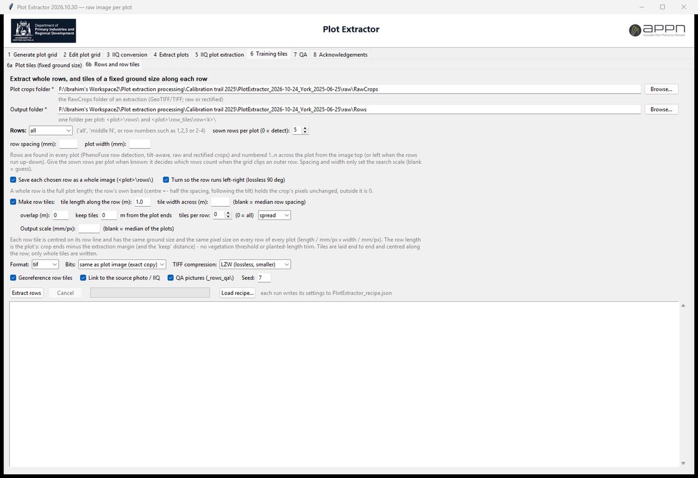

## 6 · Training tiles: middle rows (2026-10-24)

*(Since 2026-10-30 the tiles are a fixed size in metres and whole rows are on tab 6b; see
above.)*

On the **Training tiles** tab, tick **Tile only the middle N rows** to cut tiles from
the N central crop rows of every plot only (e.g. the middle 3 of 5 or 7 rows). The line
below it sets **keep tiles … m from the plot ends** (default 0.5 m).

**Tiles per plot** (2026-10-25) has its own line under Tile size and works in every mode
(plain grid, seed-row band, middle rows): 0 = every tile that fits, otherwise that many
per plot, chosen **random** (repeatable with Seed) or **spread** (evenly spaced along the
plot). On the plain grid, random back-fills tiles dropped as nodata or low vegetation;
if a plot has fewer usable tiles than asked, all of them are written.

Along the plot, tiles never reach the bare plot ends: the usable length is the plot
(crop ends moved in by the extraction margin read from `manifest.csv`), trimmed to the
planted length when the vegetation share in the band clearly drops at the ends, then
moved in by the end distance. Tiles are centred in it; the QA picture draws the usable
limits in orange, the tiles written thick cyan and the unused candidates thin blue.
Docs, figures and a narrated demo: `docs\`.

- Rows are detected in every crop with the PhenoFuse 4.0 RGB row detection
  (`row_detect.py`, ported from `phenoapp/core/grid_rows.py`): excess green on
  chromatic coordinates + Otsu, row pitch from the periodogram (17-32 cm seeder range
  when the crop carries GCPs), a comb of rows fitted at that pitch, per-row contrast.
  The row tilt is fitted from the row phase drift along the plot, so unrectified raw
  crops work as well as rectified ones.
- **Sown rows per plot**: give it when known. It decides which rows are central when
  the grid cuts an outer row; 0 = take the run of rows that are found.
- **Square tiles spanning the band** (default): each tile is as wide as the band
  (exactly the N rows, half a row spacing either side), native pixels, laid end to end
  along the plot. Untick for fixed `Tile size` tiles centred on the band.
- Written per run: `rows_report.csv` (rows found, pitch px/mm, tilt, which rows were
  used, band, plot length, usable length, tiles that fit, tiles written) and
  `_rows_qa\<plot>_rows.jpg` (rows green, band shaded, usable limits orange, tiles cyan).
- Set a **margin** at extraction (e.g. 0.10 m) when the grid is not exactly on the
  rows: outer rows are then whole in the crop and the row choice is reliable. The
  margin now also widens **rectified** crops, and **masked** crops keep plot + margin.
- **Save each row as its own image** (2026-10-25, tick on the "keep tiles" line):
  every detected row of every plot goes to `Rows\<plot>\<plot>_row<k>.png`
  (k = 1..n across the plot), the full plot length, row centre +- half a row spacing,
  following the tilt. Pixels outside the row are 0; inside they are the crop's own
  pixels (raw crops -> original camera pixels). Indexed in `Rows\rows_index.csv`
  (row, middle yes/no, present, contrast, box in the crop).
- **Early emergence** (2026-10-25): with a fraction of a percent of plant pixels the
  automatic (Otsu) green threshold falls inside the soil colours, and on a ridged
  seedbed the light ridges were taken for rows (half a row out, NUE Northam
  2026-07-03). Rows are now also found from clearly green pixels only (ExG > 0.05)
  and the result whose rows sit on more green is kept (`veg_mode` in
  rows_report.csv: `otsu` or `green`). Dense canopies are unaffected.

### Tile files: exact copies, georeference, link to the IIQ (2026-10-27)

- **Format** tif (default), png or jpeg. With tif or png and **Bits = same as plot
  image** every tile holds exactly the values of its window in the plot image (8 or 16
  bit). Bits 8 or 16 converts exactly (16 to 8: value/257 rounded; 8 to 16: value x 257).
  jpeg is lossy and 8-bit.
- **TIFF compression** LZW (default) or None - identical pixels.
- **Georeference tiles** (default on): TIFF tiles are GeoTIFFs with the plot image's CRS
  and transform moved to the tile window, so a tile pixel has exactly the coordinates of
  the same pixel in the plot image.
- **Link tiles to the source photo / IIQ** (default on): tags in each tile
  (`PLOT_IMAGE`, `PLOT_PIXEL_BOX`, `SOURCE_IMAGE`, `SOURCE_PIXEL_BOX`, `PIXEL_SOURCE`,
  `IIQ_SETTINGS`, `BIT_DEPTH`) and columns in `tile_index.csv` (`source_image`,
  `pixel_source`, `src_photo_x0`, `src_photo_y0`, `src_photo_w`, `src_photo_h`,
  `iiq_settings`, `bits`, `src_bits`, `georef`). The photo box comes from the plot
  image's box in `manifest.csv` plus the tile offset (masked / bounding box / native
  crops; rectified or stitched crops have no 1:1 box).
- All TIFF / PNG tiles are written with GDAL. QA checks every tile pixel by pixel
  (IDENTICAL, or EXACT CONVERSION for another bit depth) and its georeference.
- The ground scale of a plot image is now read from its affine georeference as well as
  from GCPs, so *Fix tile ground scale* and the end distance in metres work on current
  GeoTIFF crops.

## 7 · QA tab (2026-10-25)

Open an extraction folder (RawCrops + manifest.csv) and, optionally, its tiles folder.
The plot list shows rows found / tiles per plot and the QA flag of each plot. Per plot:

- **rows + tiles**: the row detection (rows green, missing rows red, middle band
  yellow, plot ends grey, usable length orange, tiles written cyan). Without a tiles
  folder, rows are detected on the fly (set middle rows / sown rows next to it).
- **tiles**, **saved rows**, **crop**: the images themselves.
- **QA report**: the result of **Run QA checks**, written to `<tiles>\QA\`
  (`QA_REPORT.txt`, `qa_crops.csv`, `qa_tiles.csv`, `qa_rows.csv`,
  `qa_row_images.csv`, `qa_flags.csv`):
  - raw crops vs the source frames, pixel by pixel (box from the manifest);
  - every tile vs its window in the crop, and inside the usable plot length;
  - rows: plots where rows were not found, with an unusual row count, or a row
    spacing more than 8 % from the run's median;
  - every saved row image vs the crop.
  Rectified crops are resampled by design and are only listed.

## Frame per plot (2026-10-26)

*Frame per plot* on the Extract tab (and always on the IIQ plot extraction tab):

- **Whole plot first, else the photo holding the largest part** (default): if any photo
  holds the whole plot, the most nadir / central of those is used; if none does, the
  photo that holds the largest share of the plot.
- **Nadir tiers first, then coverage**: the earlier ranking (a near-nadir photo holding
  75 %+ of the plot could beat a slightly oblique one holding all of it).

## 5 · IIQ plot extraction (tab, 2026-10-26)

The same plot-wise extraction as the Extract tab, but the pixels are **developed
directly from the Phase One IIQ raw files** with the Phase One ImageSDK instead of read
from the JPEG/TIFF renditions. Both options stay available: the Extract tab gives exact
copies of the renditions, this tab develops each plot's box from the raw file.

- Inputs: the aligned Metashape project, the plot grid (default: the current grid;
  *Browse* to use another), the folder with the `.IIQ` files (matched to the cameras by
  file name), an output folder.
- The project may be aligned on full-size JPEGs or on downscaled TIFFs (e.g. 0.3x, as in
  the APPN PhaseOne_Pipeline): camera coordinates are scaled to the IIQ frame size.
- For every plot the frame is chosen as above (whole plot first), the plot's box is
  projected into that frame and only that box is developed from its IIQ
  (`iiq_tools\p1tool.exe`). Masking, margin, partial plots, rectified/stitched crops,
  GeoTIFF, `manifest.csv` (`pixel_source` = `iiq`) and QA work as on the Extract tab.
- **Development settings**:
  - *APPN HR_clip* (default): noise reduction 0.8, sharpening 3.1 - the settings the APPN
    pipeline used; noise level like Phase One's own JPEGs.
  - *Neutral*: all processing off - closest to the sensor data, with visible colour
    noise; the only setting the SDK repeats bit for bit.
  - *APPN template*, or any Phase One ConvertConfig JSON file.
  The settings used are copied to `IIQ_settings_used.json`, the run to `IIQ_run.json`.
- **Bits and compression** (2026-10-27): *bits* 8 (default) or 16. 16 bit is the same
  development at 0-65535 (divided by 257 it matches the 8-bit image to 1/255); it works
  with the Masked and Bounding box styles and GeoTIFF / TIFF / PNG, not with JPEG or
  Rectified. *TIFF compression* LZW (default, lossless) or None; both hold the same
  pixels, LZW files are about 10% smaller. All TIFF / GeoTIFF files are written with
  GDAL; after the SDK no pixel value is changed (the mask only sets pixels outside the
  plot to 0). Recommended: GeoTIFF, LZW, 8 bit. 16 bit only for radiometric or exposure
  work, read with GDAL / rasterio / tifffile (PIL reads 16-bit RGB TIFFs wrongly).
- QA: each crop is compared with a fresh development of its box at its own bit depth
  (IDENTICAL; with noise-reduced settings MATCH = within 2/255, because the SDK's noise
  reduction is not bit-repeatable).
- The IIQ files are only read: an output folder inside the IIQ folder is refused,
  temporary files go to the output folder, and the size/time of every IIQ used is
  checked again at the end of the run.

Checked on the APPN York 2026 data (84 plots): same frame as APPN's back-projection on
77/84 (others: the next frame in the strip), same box within 1 px, pixels as close to
APPN's HR_clip clips as two HR_clip runs are to each other.

## 3 · IIQ conversion (tab, 2026-10-26)

Converts a folder of IIQ files (optionally with subfolders, mirrored) to **TIFF**
(8 or 16 bit, LZW or uncompressed), **GeoTIFF** or **JPEG**, at full size or a chosen
scale, with the same development settings. The camera EXIF / GPS / XMP is kept.
GeoTIFF needs the Metashape project the frames were aligned in: each frame gets ground
control points from its aligned camera and the DEM and an affine georeference (checked
on York 2026: within 2-5 cm of the GCPs across the frame, 0.2-1.5 cm against the
orthomosaic). A `conversion_log.csv` lists every file.

## Phase One SDK

The IIQ tabs need `iiq_tools\p1tool.exe` (included in the release) and the Phase One
ImageSDK runtime (`ImageSdkCpp.dll`, `SensorProfiles\`), which is Copyright Phase One
A/S, licensed by Phase One, and is **not** included in this repository or in the public
release. Set *Phase One SDK folder* on tab 3/5 to an SDK obtained from Phase One (the
folder with `lib\ImageSdkCpp.dll` and `SensorProfiles\`), or copy those into the
application's `_internal\iiq_tools\sdk\` (`lib\` and `SensorProfiles\`). To build `p1tool.exe`, run `iiq_tools\build_p1tool.bat "<ImageSDK folder>"`
(Visual Studio 2022 C++ build tools), with an SDK obtained from Phase One.

## 8 · Acknowledgements

- The IIQ plot extraction follows the approach of the **APPN-UQ PhaseOne_Pipeline**
  (Australian Plant Phenomics Network, The University of Queensland node; contact
  appn@uq.edu.au): back-projecting the plot corners into the aligned frames and
  developing each plot's box directly from the IIQ with the Phase One ImageSDK.
  `iiq_tools\src\p1tool.cpp` is adapted from its `IIQ_Proc` tools and the *APPN HR_clip*
  / *APPN template* presets are its `config_hr` settings (MIT licence, Copyright (c) 2025
  APPN-UQ - see `THIRD_PARTY_NOTICES.md`).
- **What we changed in their method** (also listed on tab 8): a photo holding the whole
  plot first, else the photo holding the largest part (theirs drops plots not wholly in
  one photo), or a stitched whole plot; the whole polygon plus a margin projected with
  the full camera model; the exact frame scale (12768/3830, not 1/0.3) and projects
  aligned on full-size JPEGs as well as 0.3x TIFFs; masked / bounding-box / rectified
  output as TIFF, GeoTIFF, PNG or JPEG named by Plot ID (no overwriting), with EXIF,
  manifest and candidates; `p1tool` rewritten for batches (Unicode paths, 8/16 bit,
  TIFF/JPEG/raw output) with a Neutral preset; the IIQ folder protected and re-checked,
  and a QA re-development check; whole-frame IIQ conversion with georeferencing (tab 3).
- **Phase One ImageSDK**, Copyright Phase One A/S, used under Phase One's SDK licence.
- A stand-alone IIQ converter (JPEG / GeoTIFF, GUI) from the DPIRD APPN node:
  https://github.com/appndpird/P1ImageSDK-IIQ-Converter (Bipul Neupane, DPIRD).
- Everything else in PlotExtractor (tabs 1, 2, 4, 6 and 7, and the extraction engine
  shared by tabs 4 and 5) was developed by DPIRD for the APPN node in Western Australia.

## Output files

- `RawCrops\plot_<id>.<ext>` — one raw-image crop per plot.
- `OrthoCrops\plot_<id>.<ext>` — one deskewed orthomosaic crop per plot.
- `RawCrops\plot_<id>_seam.png` — optional per-pixel "which frame" QC map.
- `manifest.csv` — one row per plot.
- `candidates.csv` — one row per (plot, candidate frame): `rank`, `camera`,
  `cover_pct`, `cover_m2`, `corners_in_frame`, `aniso` (1.0 = nadir), `mm_per_px`,
  `used`. This is the record of **all** the images available for a plot and which one
  was chosen.

**`manifest.csv` columns:** `plot_id`, `plot_area_m2` (true polygon area), `margin_m`,
`raw_image`, `raw_file`, `crop_w`, `crop_h`, `corners_in_frame`,
`raw_covered_pct` / `raw_covered_m2` (how much of the plot the delivered crop actually
holds), `cand_frames` (how many raw frames see this plot), `best_frame` /
`best_cover_pct` / `best_cover_m2` (the single best frame and how much of the plot it
covers on its own — the "best raw image per plot" record), `frames_used` (1 = seamless,
2+ = stitched), `seam_y_pct` (where the seam sits; an `x` prefix means a vertical seam),
`fit_rows` / `fit_width_m` / `fit_length_m` / `fit_area_m2`, `ortho_file`,
`ortho_covered_pct` / `ortho_covered_m2`, `source_path`, `raw_style` (mask / native /
bbox / rectify / ortho-fallback), `src_x0`, `src_y0`, `src_x1`, `src_y1` (the box in
the source frame a native/bbox/mask crop was cut from: crop pixel (0, 0) = frame pixel
(src_x0, src_y0), so a crop can be checked against its original), `note`. Coverage below 100%
means part of the plot fell outside every usable frame (raw) or the orthomosaic had
holes (ortho).

## Requirements (running from source, Python 3.11)

```
pip install <Metashape wheel from agisoft.com/downloads> pillow pyshp
```

A valid Metashape license is required — the app uses the floating license server
configured in `C:\Program Files\Agisoft\Licensing\licenses`.

## Troubleshooting

- **"No valid Metashape license"** — license server unreachable (VPN/network).
- **"plots are ~X km away from the project centre"** — wrong CRS or wrong .psx.
- **"raw file missing"** — set the *Raw images folder* to where the photos live
  (e.g. the project's `JPEG` folder).
